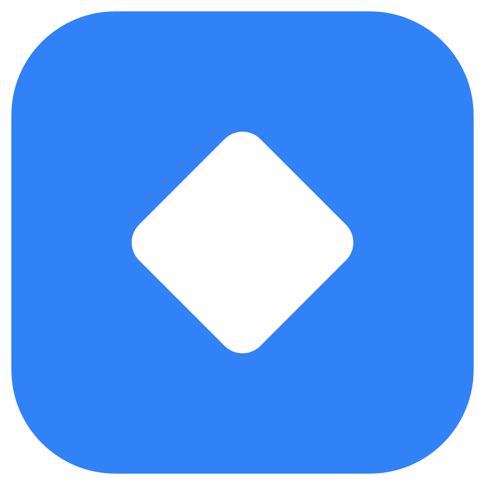

<div align="center">

# Atelier



NovelAI·GPT 이미지를 만들고 고르는 Windows 데스크톱 앱

[](LICENSE)

</div>

---

Atelier는 [NAIS3](https://github.com/sunanakgo/NAIS3)(sunanakgo)에서 갈라져 나온 개조판이에요. 캐릭터챗 작품에 쓸 그림을 많이 뽑고 고르는 일에 맞춰 고쳤어요. 원본과 따로 개발하고, 원본의 업데이트를 받지 않아요.

## 할 수 있는 것

- **생성**: NovelAI V4.5·V5 텍스트→이미지, i2i, 인페인트, 캐릭터 프롬프트, 바이브·레퍼런스
- **씬**: 장면별 프롬프트를 저장해 두고 예약한 만큼 한 번에 생성, 프리셋 폴더 정리
- **선별**: 뽑은 그림을 씬별로 골라 남기기
- **디렉터·라이브러리**: NAI 디렉터 도구, 저장한 그림 모아 보기
- **GPT 이미지**: ChatGPT 계정으로 이미지 만들기·고치기
- **표지**: 작품 표지 만들기
- **알림**: 캐릭터챗 플랫폼 11곳(에덴·베이비챗·루나·엘린·네코·티팟·크랙·알플레이·젠잇·우마이·챗플)의 알림과 댓글을 한 화면에 모아 보기, 되는 플랫폼은 답글 달기
- **작품**: 내가 올린 작품이 어느 플랫폼에 올라가 있는지 한 표로 보기
- **AI 비서**(Ctrl+K): Claude에게 씬 프리셋 정리나 프롬프트 쓰기를 말로 시키기

## 설치

1. [Releases](https://github.com/seotk0319/Atelier/releases/latest)에서 `atelier-<버전>-setup.exe`를 받아 실행해요. Windows x64용이에요.
2. 바탕화면과 시작 메뉴에 `Atelier` 바로가기가 생겨요.
3. 새 버전은 설정(오른쪽 위 톱니) → **정보** → **업데이트 확인**으로 받아요.

## 처음 연결

모두 설정(오른쪽 위 톱니)에서 넣어요. 키와 토큰은 Windows 사용자 암호로 잠가 이 PC에만 저장해요.

| 쓰려는 것 | 필요한 것 | 넣는 곳 |
|---|---|---|
| NovelAI 생성 | NovelAI 영구 API 토큰(`pst-`로 시작). NovelAI 웹 → Account Settings → Get Persistent API Token | 설정 → **NAI 계정** |
| GPT 이미지 | ChatGPT 계정으로 로그인한 Codex CLI. [Node.js](https://nodejs.org/)를 깐 뒤 명령 창에서 `npm i -g @openai/codex`, `codex login`. Atelier는 그 로그인 파일(`%USERPROFILE%\.codex\auth.json`)을 읽어요 | 따로 넣을 곳 없음. GPT 이미지 탭 오른쪽 위 연결 표시를 누르면 다시 확인해요 |
| AI 비서 | Claude API 키([console.anthropic.com](https://console.anthropic.com/)) | 설정 → **AI 비서** |
| AI 태그 도우미 | OpenRouter 키([openrouter.ai](https://openrouter.ai/keys)). DeepSeek V4.1 Flash를 써요 | 설정 → **AI 도우미** |
| 알림·작품 | 플랫폼 계정과 크롬(없으면 엣지). 로그인 창은 Atelier 전용 크롬 프로필로 열려서 평소 쓰는 크롬과 섞이지 않아요 | **알림** 탭 → **연결 관리** → 플랫폼마다 **로그인**. 로그인한 뒤 그 창을 닫으면 연결돼요 |

NovelAI 생성에는 Anlas나 Opus 구독이 필요해요. 화면 위쪽 **Anlas 소모** 스위치를 끄면 Anlas가 드는 생성은 막혀요.

## 데이터 폴더

- 설정·기록·라이브러리: `%APPDATA%\Atelier` (`nais3.db` 등)
- 그림: 기본은 `사진\Atelier\NAIS3_output`, 씬은 `사진\Atelier\NAIS3_scene`. 설정 → **저장**에서 바꿀 수 있어요.
- 앱을 지워도 두 폴더는 남아요. 완전히 지우려면 직접 지워 주세요.
- 설정 → **저장** → **데이터 백업**으로 라이브러리를 JSON으로 내보내고 불러올 수 있어요(NAIS2 백업도 불러와요).

- 플랫폼 로그인 정보와 모은 알림: `%APPDATA%\Atelier\creator-inbox`, 로그인용 크롬 프로필은 `%APPDATA%\Atelier\moa-login`. 로그인 정보는 이 PC에만 저장해요. **연결 관리**의 **해제**를 누르면 그 플랫폼의 로그인 정보를 지워요.

## 개발

```bash
npm install
npm run dev        # 개발 모드
npm test           # vitest
npm run typecheck
npm run build:win  # 설치 파일 (dist/)
```

Electron + electron-vite, React 19, TypeScript, Tailwind CSS v4, better-sqlite3, Zustand, sharp.

## 원본과 라이선스

- 원본: [sunanakgo/NAIS3](https://github.com/sunanakgo/NAIS3) — 원저작권은 원저작자에게 있어요. 원본의 문의·후원 창구는 원본 저장소를 봐 주세요.
- 이 저장소는 GPL-3.0에 따라 고친 소스를 공개해요. 자세한 건 [LICENSE](LICENSE).
- GPT 이미지 연결 방식은 [lidge-jun/ima2-gen](https://github.com/lidge-jun/ima2-gen)(MIT)을 참고했어요.
- NovelAI API 동작을 이해하는 데 SDStudio, NAIA 2.0을 참고했어요(원본 NAIS3의 감사 글).
